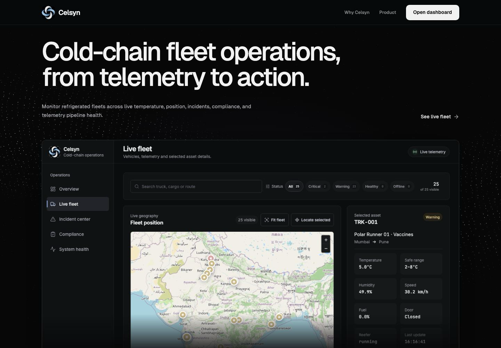
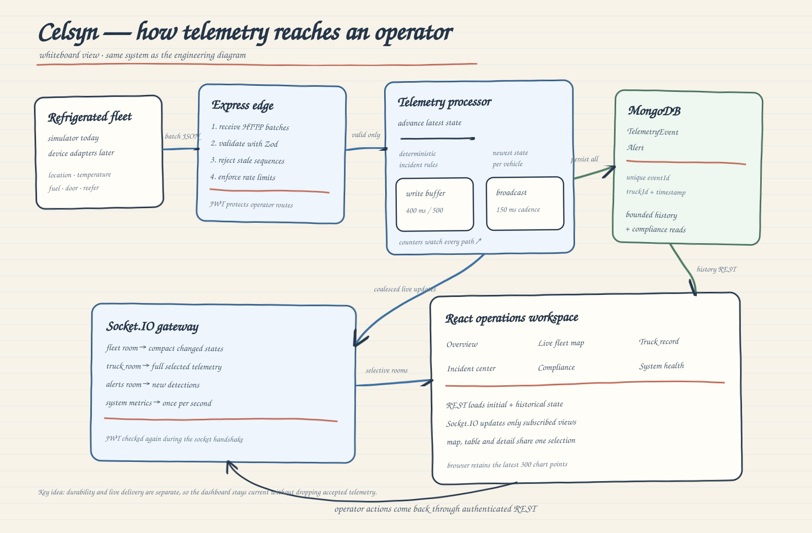

<p align="center">
  
</p>

<h1 align="center">Celsyn</h1>

<p align="center">
  <strong>Real-time cold-chain fleet operations — from telemetry to action.</strong>
</p>

<p align="center">
  <a href="https://client-pink-three-61.vercel.app"></a>
  <a href="https://d4v3wx0jtp0fj.cloudfront.net/api/health"></a>
  
  
</p>

<p align="center">
  <code>React 19</code> &nbsp;·&nbsp; <code>Node.js</code> &nbsp;·&nbsp; <code>Express 5</code> &nbsp;·&nbsp; <code>MongoDB</code> &nbsp;·&nbsp; <code>Socket.IO</code> &nbsp;·&nbsp; <code>Leaflet</code> &nbsp;·&nbsp; <code>Recharts</code>
</p>

<br />



<br />

> 🚀 **Live Demo:** [https://client-pink-three-61.vercel.app](https://client-pink-three-61.vercel.app)
>
> ⚙️ **Backend API:** [https://d4v3wx0jtp0fj.cloudfront.net](https://d4v3wx0jtp0fj.cloudfront.net) &nbsp;·&nbsp; Login: `demo@chainpulse.dev` / `chainpulse-demo`

---

## 📖 Overview

Temperature-sensitive cargo can be damaged long before an operations team realizes a refrigeration unit has failed, a cargo door is open, or a vehicle has left its safe operating zone. **Celsyn** gives operators one live view of fleet health — individual truck telemetry, historical temperature trends, incident alerts, cold-chain compliance analytics, and pipeline performance metrics, all in real time.

Built for the **MERNIFY Hackathon** — High-Throughput Streams & Telemetry track. Celsyn validates and processes high-frequency vehicle telemetry events, persists the complete accepted stream to MongoDB, runs deterministic incident detection, and streams selective live updates to an authenticated operations workspace via Socket.IO.

---

## 🧭 Navigate

- [✨ Feature Set](#-feature-set)
- [🏗️ Architecture](#%EF%B8%8F-architecture)
- [⚙️ Technology Stack](#%EF%B8%8F-technology-stack)
- [📁 Repository Structure](#-repository-structure)
- [🚀 Run the Demo Locally](#-run-the-demo-locally)
- [🌐 REST API](#-rest-api)
- [⚡ Socket.IO Protocol](#-socketio-protocol)
- [📊 Performance & Stress Testing](#-performance--stress-testing)
- [🧪 Tests](#-tests)
- [📦 Attribution](#-attribution)

---

## ✨ Feature Set

### 🚛 Fleet Simulation
- Configurable refrigerated-fleet simulator with cargo-specific safe temperature ranges and routes
- Gradually evolving location, temperature, humidity, speed, fuel, door-state, and reefer telemetry
- Simulator reads current sequences from the API on startup — safe to restart without stale events

### 📡 Ingestion Pipeline
- Zod-validated single (`POST /api/telemetry`) and batch (`POST /api/telemetry/batch`, up to 500 events) ingestion
- Latest-state fleet model with **stale-sequence rejection** — out-of-order events are discarded
- Buffered MongoDB persistence with **unique `eventId` deduplication** via `insertMany` + duplicate-key handling
- Rate limiting: 6,000 requests per minute with RFC-compliant `RateLimit` headers

### ⚡ Real-Time Delivery
- **Socket.IO rooms** — `fleet`, `truck:{id}`, and `alerts` for independent client subscriptions
- **150 ms coalesced broadcast scheduler** — sends only the newest state per truck, never the full raw stream
- Selective payload serialization (`compactTruckState`) — only changed fields cross the wire
- JWT-authenticated WebSocket connections via `handshake.auth.token`

### 🔔 Incident Detection
- **5 alert types** with 60-second incident cooldowns:
  - `TEMPERATURE_WARNING` — temperature outside safe cargo range
  - `TEMPERATURE_CRITICAL` — ≥3°C outside safe range
  - `REEFER_FAILURE` — refrigeration unit failure
  - `DOOR_OPEN_WHILE_MOVING` — cargo door open above 10 km/h
  - `LOW_FUEL` — fuel below 15%
- Alerts persisted to MongoDB and streamed live to subscribed clients

### 📈 Analytics & History
- Bounded chronological historical queries with `timestamp` + `truckId` index
- **Cold-chain compliance analytics** — time-weighted compliance %, excursion detection, min/max/avg temperature, worst deviation across 60 min, 6 hr, and 24 hr windows
- Historical + live data merged client-side by `eventId`, ordered by timestamp then sequence, capped at 300 chart points

### 🖥️ Dashboard
- **Overview** — fleet health summary, live status counters
- **Live Fleet Map** — Leaflet map with 25 real-time moving truck markers, status colours, synchronized selection
- **Truck Record** — live telemetry, stored history chart, compliance report, truck-specific incidents
- **Incidents** — searchable alert triage with fleet navigation
- **Compliance** — temperature excursion analysis from stored MongoDB history
- **System Health** — live pipeline visualization: throughput, broadcast latency, MongoDB persistence, connected clients

---

## 🏗️ Architecture

<p align="center">
  
</p>

The backend ingests many events between visual refreshes. The broadcast scheduler keeps only the **newest changed state per truck** while every accepted event is still buffered for MongoDB persistence. The ingestion path and the visualization path are fully decoupled.

The [detailed architecture document](docs/architecture.md) covers component ownership, data contracts, ingestion and delivery sequences, Socket.IO rooms, frontend routing, security boundaries, performance controls, failure behavior, and a scale-out path.

```
Simulator → POST /api/telemetry/batch
         → Zod Validation → Sequence Check
         → Fleet State Map (latest state)
         → Anomaly Detector → Alert persisted + Socket emitted
         → Persistence Buffer → MongoDB insertMany (400ms / 500 events)
         → Telemetry Events → Socket.IO Broadcast Scheduler (150ms)
                            → fleet room (summary + changed trucks)
                            → truck:{id} room (full state)
```

---

## ⚙️ Technology Stack

| Layer | Technology |
|-------|-----------|
| 🎨 **Frontend** | React 19, Vite 8, React Router 7, Socket.IO Client 4, Recharts 3, Leaflet 1.9 |
| 🛠️ **Backend** | Node.js, Express 5, Socket.IO 4, Zod 4, express-rate-limit, jsonwebtoken |
| 🗄️ **Database** | MongoDB, Mongoose 9 |
| 🔐 **Security** | JWT (8-hour tokens), rate limiting, Zod strict validation |
| 🧪 **Testing** | Vitest, Supertest, Socket.IO Client |
| ☁️ **Deployment** | AWS EC2 + CloudFront (backend), Vercel (frontend) |

---

## 📁 Repository Structure

```text
Celsyn/
├── client/                    React + Vite dashboard
│   ├── src/
│   │   ├── components/        Shared panels, map, and chart components
│   │   ├── hooks/             REST + Socket.IO state orchestration
│   │   ├── pages/             Dashboard screens (Overview, Fleet, Truck, Incidents…)
│   │   └── services/          Authenticated API client
│   └── vercel.json            SPA routing config
│
├── server/
│   ├── scripts/
│   │   ├── simulate.js        25-truck configurable simulator CLI
│   │   └── stress.js          Performance stress-test CLI (up to 20k events/sec)
│   └── src/
│       ├── models/            MongoDB schemas (TelemetryEvent, Alert)
│       ├── routes/            REST endpoints
│       ├── services/          Fleet state, anomaly detection, persistence, compliance analytics
│       ├── sockets/           Selective real-time broadcast gateway
│       └── middleware/        JWT auth, rate limiting
│
├── deploy/aws/                CloudFormation, Dockerfile, Docker Compose, Nginx
└── docs/                      Architecture notes, diagrams, design system
```

---

## 🚀 Run the Demo Locally

### Prerequisites
- Node.js 20 or newer
- npm
- MongoDB (local or Atlas URI)

### Install

```bash
git clone git@github.com:ARF9792/Celsyn.git
cd Celsyn
npm install
cp server/.env.example server/.env
cp client/.env.example client/.env
```

### Environment Variables

**Server** (`server/.env`):
```dotenv
MONGODB_URI=mongodb://127.0.0.1:27017/chainpulse
PORT=5000
CLIENT_URL=http://localhost:5173
NODE_ENV=development
TELEMETRY_FLUSH_INTERVAL_MS=400
TELEMETRY_MAX_BATCH_SIZE=500
JWT_SECRET=replace-with-a-long-random-secret
DEMO_USER_EMAIL=demo@chainpulse.dev
DEMO_USER_PASSWORD=chainpulse-demo
```

**Client** (`client/.env`):
```dotenv
VITE_API_URL=http://localhost:5000
VITE_MAP_TILE_URL=https://tile.openstreetmap.org/{z}/{x}/{y}.png
VITE_MAP_ATTRIBUTION=&copy; OpenStreetMap contributors
```

### Start

Open three terminals from the repository root:

```bash
# Terminal 1 — API server
npm start

# Terminal 2 — React dashboard
npm run dev:client

# Terminal 3 — 25-truck simulator
npm run simulate -- --trucks=25 --interval=200
```

Open [http://localhost:5173](http://localhost:5173) and sign in:

```
Email:    demo@chainpulse.dev
Password: chainpulse-demo
```

### Trigger a Live Incident

1. Sign in and select any truck from the fleet map
2. Click **Trigger temperature excursion**
3. Watch temperature rise, reefer fail, truck status flip to critical, and alerts stream in live

> The demo endpoint is disabled when `NODE_ENV=production`.

---

## 🌐 REST API

All dashboard endpoints require `Authorization: Bearer <token>`. Telemetry ingestion and sequence bootstrapping are open to the simulator.

| Method | Endpoint | Description |
|--------|----------|-------------|
| `POST` | `/api/auth/login` | Obtain an 8-hour operator token |
| `GET` | `/api/auth/me` | Validate the current session |
| `POST` | `/api/telemetry` | Ingest a single telemetry event |
| `POST` | `/api/telemetry/batch` | Ingest up to 500 events in one request |
| `GET` | `/api/telemetry/sequences` | Bootstrap simulator sequence numbers |
| `GET` | `/api/trucks` | Fleet metadata and latest state |
| `GET` | `/api/trucks/:truckId` | Single truck snapshot |
| `GET` | `/api/trucks/:truckId/history` | Bounded chronological telemetry history |
| `GET` | `/api/trucks/:truckId/compliance` | Time-weighted cold-chain compliance analytics |
| `GET` | `/api/fleet/summary` | Fleet health counts |
| `GET` | `/api/alerts` | Recent in-session alerts |
| `GET` | `/api/system/metrics` | Live pipeline performance counters |
| `POST` | `/api/demo/trucks/:truckId/temperature-excursion` | Activate a 30-second demo failure |

History accepts `minutes`, `from`, `to`, and `limit` query parameters (capped to prevent unbounded datasets).

Compliance analytics reports minimum, maximum, and average temperature; time and sample counts outside the safe range; compliance percentage; excursion count with durations and worst deviation. Analysis is capped at 50,000 samples and marks truncated responses explicitly.

---

## ⚡ Socket.IO Protocol

Clients connect with their JWT in `socket.handshake.auth.token`.

**Client → Server**
```
subscribe:fleet          Join the fleet room
unsubscribe:fleet        Leave the fleet room
subscribe:truck          Join truck:{truckId} room
unsubscribe:truck        Leave truck:{truckId} room
subscribe:alerts         Join the alerts room
```

**Server → Client**
```
fleet:update    Compact changed-truck states + fleet health summary  (every 150ms)
truck:update    Full latest telemetry for the subscribed truck room   (every 150ms)
alert:new       Newly detected incident                               (immediate)
system:metrics  Pipeline performance counters                         (every 1s)
```

> The server never broadcasts every raw event to every client — only the newest changed state per truck reaches the wire.

### Historical + Live Merge

When a truck is selected, the dashboard:
1. Clears the previous truck series
2. Fetches bounded MongoDB history via REST
3. Subscribes to `truck:{truckId}`
4. Merges live and historical points by `eventId`
5. Orders by timestamp, then sequence
6. Caps at **300 points** in browser memory

Socket listeners are removed on unmount. Reconnection resubscribes automatically without duplicating chart points.

---

## 📊 Performance & Stress Testing

### Batching Controls

| Control | Value |
|---------|-------|
| Max events per batch | 500 |
| Persistence flush interval | 400 ms |
| Persistence batch size | 500 events |
| Socket.IO broadcast interval | 150 ms (≈6–7 visual updates/sec) |
| Client chart history cap | 300 points |
| Ingestion rate limit | 6,000 req/min |

### Stress Test

```bash
npm run stress -- --trucks=25 --rate=5000 --duration=5 --batch-size=500
```

Options: `--trucks` (1–25) · `--rate` (1–20,000 events/sec) · `--duration` (1–300s) · `--batch-size` (1–500) · `--backend-url`

**Measured result — 13 November 2026:**

```
Events generated    25,000
Events accepted     25,000      ✓  0 rejected · 0 failed requests
Duration            4.999 s
Throughput          5,000.7 events/second
MongoDB persisted   25,000
Avg latency         56.68 ms    (ingestion → broadcast)
```

---

## 🧪 Tests

```bash
npm test          # Run all tests
npm run build     # Production build
npm audit         # Dependency audit
```

The backend test suite covers: health checks, Zod validation, single and batch ingestion, stale-sequence rejection, fleet state management, persistence batching and deduplication, simulator correctness, anomaly cooldowns, selective two-client Socket.IO delivery, JWT protection, and pipeline metrics.

---

## 📦 Attribution

Celsyn is built on open-source packages listed in `package.json`, including **React**, **Vite**, **Leaflet**, **Express**, **MongoDB / Mongoose**, **Socket.IO**, **Zod**, **Recharts**, **JSON Web Token**, **Vitest**, and **Supertest**.

Default map tiles are © [OpenStreetMap contributors](https://www.openstreetmap.org/copyright), with attribution displayed inside the map.

---

<p align="center">
  Built with ❤️ for MERNIFY Hackathon &nbsp;·&nbsp;
  <a href="https://client-pink-three-61.vercel.app">Live Demo</a> &nbsp;·&nbsp;
  <a href="docs/architecture.md">Architecture</a>
</p>
