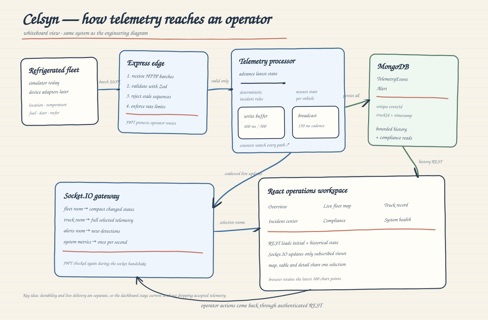
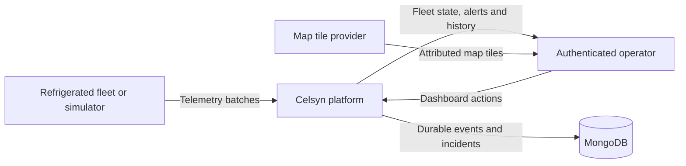
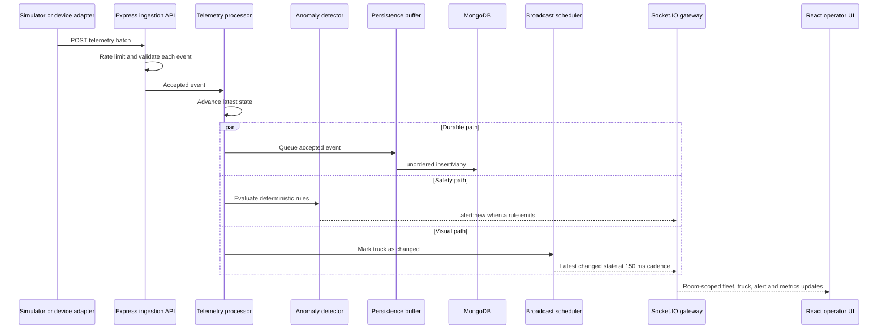
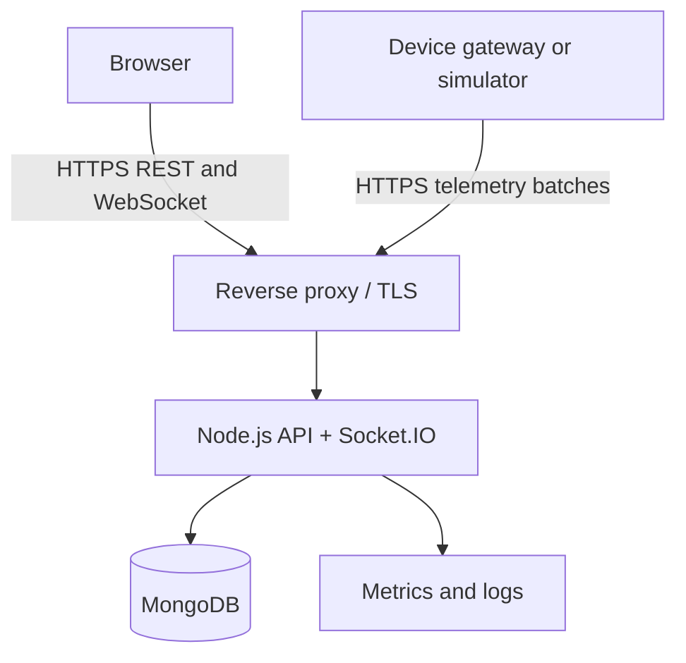

# Celsyn architecture

Celsyn is a real-time cold-chain operations platform. It accepts high-frequency vehicle telemetry, maintains a current fleet view, persists the complete accepted event stream, detects safety incidents, and selectively delivers live updates to authenticated operators.

The hackathon demonstration loads 25 simulated refrigerated vehicles. That is a demo dataset choice, not a frontend capacity constant: fleet records, status counts, filtering, map markers, subscriptions, and tables are derived from the backend response.

## Architecture diagram



## System context



The simulator is the current telemetry source. In a production deployment, device gateways or partner adapters can emit the same event contract without changing the processor, persistence service, real-time gateway, or frontend data model.

## Runtime components

| Area | Component | Responsibility |
| --- | --- | --- |
| Source | Fleet simulator | Maintains realistic per-vehicle state and sends configurable telemetry batches. |
| API edge | Express routes | Exposes authentication, ingestion, fleet, truck, history, compliance, alerts, metrics, and demo endpoints. |
| Trust boundary | Zod validation and rate limiting | Rejects malformed payloads, unknown fields, unregistered trucks, stale sequences, and excessive ingestion traffic. |
| Processing | Telemetry processor | Advances the latest state and sends each accepted event into detection, persistence, metrics, and broadcast paths. |
| Current state | Latest-state Map | Serves fast fleet and truck snapshots without rebuilding state from MongoDB for every request. |
| Detection | Anomaly detector | Evaluates temperature, reefer, moving-door, and fuel rules with recovery-aware cooldowns. |
| Persistence | Buffered writer | Flushes unordered MongoDB batches every 400 ms or at 500 buffered events. |
| Real time | Broadcast scheduler | Retains the newest changed state per truck and emits visual updates every 150 ms. |
| Delivery | Socket.IO gateway | Authenticates clients and scopes fleet, truck, alert, and metrics updates to subscribed rooms. |
| Analytics | History and compliance services | Return bounded chronological samples and time-weighted temperature compliance. |
| Frontend | React operations workspace | Combines initial REST state with Socket.IO updates across the Overview, Live Fleet, truck record, incidents, compliance, and system-health screens. |

## Telemetry event contract

Every telemetry event contains:

- globally unique `eventId`;
- registered `truckId`;
- monotonically increasing per-truck `sequence`;
- ISO-8601 `timestamp`;
- latitude and longitude;
- temperature and humidity;
- speed and fuel level;
- cargo-door state;
- reefer state and power.

Zod validates bounds and rejects unknown fields before processing. A registered-truck check prevents arbitrary identifiers from entering the fleet model. The latest-state service rejects a stale or repeated sequence even when the payload is otherwise valid.

## Ingestion and delivery sequence



The API acknowledges accepted events without waiting for a visualization broadcast. Persistence and visual delivery are separate paths: every accepted event is queued for MongoDB, while the scheduler coalesces intermediate states that would not be useful to render.

## Persistence and indexes

### `TelemetryEvent`

- Unique `eventId` index provides idempotency.
- `{ truckId: 1, timestamp: 1 }` supports bounded chronological history.
- Unordered `insertMany` allows valid documents in a batch to persist even when a duplicate is encountered.

### `Alert`

- Truck and timestamp index supports vehicle incident history.
- Severity and timestamp index supports recent incident review.

### Buffer behavior

The persistence buffer flushes every 400 ms or when it reaches 500 events. Graceful shutdown drains the buffer before closing MongoDB so normal termination does not abandon queued telemetry.

## Incident detection

| Rule | Severity |
| --- | --- |
| Slightly outside the cargo-safe temperature range | Warning |
| At least 3°C outside the configured safe range | Critical |
| Reefer state is `failed` | Critical |
| Cargo door is open above 10 km/h | Warning |
| Fuel is below 15% | Warning |

An incident key combines the truck and rule type. An active condition emits once and then respects a 60-second cooldown. Recovery clears the key, so a later recurrence can emit immediately rather than waiting for the old cooldown.

## Real-time protocol

Clients authenticate through `handshake.auth.token` and subscribe only to the views they need.

| Room or event | Payload and use |
| --- | --- |
| `fleet` / `fleet:update` | Compact changed-truck states, current coordinates, and fleet summary. |
| `truck:<truckId>` / `truck:update` | Full latest telemetry for the selected truck. |
| `alerts` / `alert:new` | Newly detected safety incident. |
| `system:metrics` | Throughput, persistence, delivery, connected-client, and latency counters once per second. |

Truck subscriptions validate the requested identifier against the registered fleet. Reconnection restores fleet, alert, and selected-truck subscriptions without duplicating listeners.

## Frontend architecture

```text
App router
├── /                         Landing page
├── /login                    Seeded demo authentication
└── /app                      Authenticated shared shell
    ├── /overview             Fleet posture and attention queue
    ├── /fleet                Map, filters, directory and selected-truck telemetry
    ├── /fleet/:truckId       Dedicated truck record
    ├── /incidents            Searchable incident queue and detection detail
    ├── /compliance           Stored-telemetry compliance analytics
    └── /system               Pipeline health and counters
```

`useDashboardData` owns the shared operational state:

1. authenticate and bootstrap fleet, summary, alerts, metrics, and selected-truck history through REST;
2. connect Socket.IO with the same access token;
3. subscribe to fleet, alert, metrics, and selected-truck updates;
4. merge compact fleet changes into the current truck collection;
5. merge historical and live truck points by `eventId`;
6. order points by timestamp and sequence;
7. retain the latest 300 chart points in browser memory;
8. expose one selected truck ID to the map, table, details panel, incidents, and compliance screens.

The shared application shell owns navigation, connection state, the home-brand link, and the demo-environment disclosure. Individual screens remain focused on presentation and view-specific filters.

## Map architecture

The Live Fleet map initializes markers from the authenticated fleet snapshot. Compact `fleet:update` messages change marker coordinates and status without recreating the map. Filtering changes marker visibility while preserving the underlying live fleet state. Map marker selection, table selection, and the details panel share the same selected truck ID.

Leaflet renders OpenStreetMap tiles by default and keeps provider attribution visible. Production deployments should configure a suitable tile provider or self-hosted tiles rather than relying on the public demonstration endpoint for high traffic.

## Compliance analytics

Compliance is calculated from stored telemetry against the selected truck's cargo-safe range. The service reports:

- minimum, maximum, and average temperature;
- observed and compliant duration;
- out-of-range samples and duration;
- compliance percentage;
- excursion windows, direction, duration, sample count, and maximum deviation;
- maximum observed sample gap;
- actual analyzed time bounds and truncation state.

Queries are bounded to the latest 50,000 samples and at most 50 recent excursions. Gaps longer than 60 seconds are not fully attributed to the previous reading.

## Authentication and trust boundaries

- The demo login returns an eight-hour JWT.
- Dashboard REST requests send the token as a bearer credential.
- Socket.IO validates the token during the handshake.
- Telemetry ingestion remains available to the simulator but is schema-validated and rate-limited.
- The development-only excursion endpoint is disabled in production.
- Secrets and environment-specific connection strings remain outside Git.

The seeded operator is intentionally simple for a hackathon demonstration. A production identity layer would add persistent users, password reset or federation, organizations, roles, and audit records without changing the telemetry event contract.

## Performance controls

- Simulator traffic is batched rather than sent as one request per event.
- Ingestion accepts at most 500 events in a batch.
- MongoDB writes are buffered and unordered.
- Duplicate event IDs do not fail the remainder of a batch.
- Socket.IO coalesces intermediate states per truck at the visualization boundary.
- Clients receive only subscribed fleet or truck streams.
- History endpoints and browser chart memory are bounded.
- Live metrics expose received, accepted, rejected, dropped, persisted, duplicate, coalesced, broadcast, connected-client, and latency values.

These controls let ingestion frequency and rendering frequency scale independently.

## Failure behavior and graceful shutdown

- Invalid or stale events are rejected before they mutate current state.
- MongoDB duplicate keys are counted without failing valid neighboring writes.
- Socket reconnection resubscribes to the necessary rooms.
- Missing live data is represented as disconnected or offline state rather than fabricated values.
- `SIGINT` and `SIGTERM` stop new connections, disconnect sockets, drain persistence, close MongoDB, and exit.

## Deployment shape



The current repository runs the React build and Node service separately. A production deployment should add TLS termination, trusted origins, managed secrets, a production tile provider, MongoDB backups, health probes, centralized logs, and alerting on persistence depth, rejection rate, and broadcast latency.

## Scale-out path

The current latest-state Map, cooldown registry, recent-alert collection, and scheduler are process-local. Scaling to multiple API instances would require shared coordination:

1. put a load balancer in front of stateless ingestion nodes;
2. move the event stream to a broker such as Kafka, NATS, or Redis Streams;
3. keep durable telemetry in MongoDB or a time-series store;
4. store latest state and incident cooldowns in a shared low-latency store;
5. use a Socket.IO adapter for cross-instance rooms;
6. partition processing by truck ID so sequence order remains deterministic;
7. preserve the existing frontend contracts while increasing infrastructure capacity.

This is an evolution path, not functionality claimed by the current hackathon build.

## Repository ownership

```text
client/src/pages/             Route-level operational screens
client/src/components/        Shared panels, tables, charts, map and branding
client/src/hooks/              REST + Socket.IO state orchestration
client/src/services/           Authenticated API client
server/src/routes/             REST boundary
server/src/services/           Processing, detection, persistence, metrics and auth
server/src/sockets/            Room-scoped real-time gateway
server/src/models/             MongoDB schemas and indexes
server/scripts/                Simulator and stress-test CLIs
server/test/                   Unit and integration coverage
```

## Architectural decisions

| Decision | Reason |
| --- | --- |
| Separate persistence from visualization scheduling | Rendering every accepted event would waste client work, while dropping events before persistence would lose history. |
| Keep a latest-state Map | Fleet reads and live status calculations should not require a database aggregation on every update. |
| Use deterministic detection rules | Hackathon behavior remains reproducible and testable without inventing machine-learning claims. |
| Scope Socket.IO rooms by view | Operators receive relevant updates rather than every full event for every truck. |
| Bound history and browser memory | Charts remain responsive during long simulator runs. |
| Share one selected truck ID | Map, table, details, incidents, and compliance stay synchronized. |
| Preserve a single telemetry contract | The simulator can later be replaced by device adapters without rewriting downstream services. |
